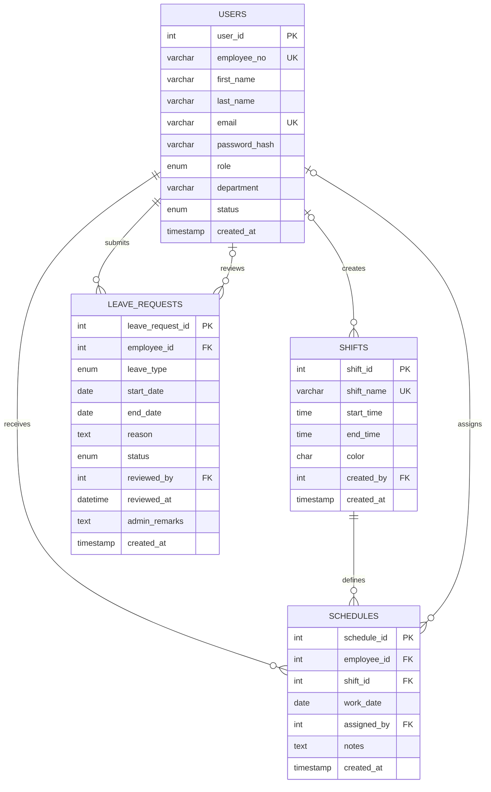

# ShiftSync Database ERD

## Relationship notes

- One user (employee) can have many schedule records; each schedule is assigned to one employee.
- One shift type can be used in many schedule records; each schedule uses one shift type.
- An administrator/user may assign many schedules. `assigned_by` is nullable if the assigning account is later removed.
- One employee can submit many leave requests; each request belongs to one employee.
- An administrator/user may review many leave requests. `reviewed_by` and `reviewed_at` remain empty until a decision is made.
- A user may create multiple shift types. `created_by` is optional.
- `uq_schedule_employee_date` means this version allows at most one assigned shift per employee per date. Remove or adjust that constraint if split shifts are required.
- The `users` table stores a `password_hash`, never a plaintext password. The frontend demo password is only for the local prototype and must not be reused as backend authentication.
