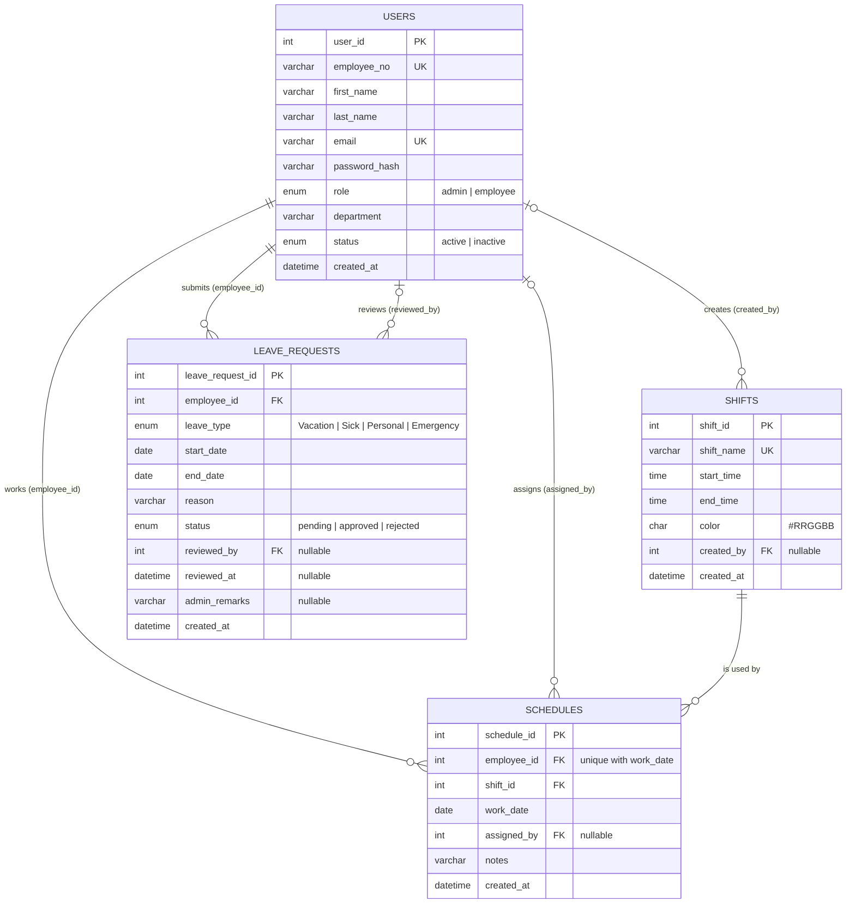

# ShiftSync Database Design (MySQL)

Four tables cover everything the current prototype stores: **users**, **shifts**, **schedules**, **leave_requests**.
The design is normalized (3NF): each fact is stored once, and tables link through foreign keys.
`schema.sql` is the matching implementation (MySQL 8.0.16+ / MariaDB 10.2+).

## ER Diagram

## Tables

### users: administrators and employees
One table, split by `role`, so a single login system serves both.

| Column | Type | Constraints |
|---|---|---|
| user_id | INT UNSIGNED | **PK**, auto-increment |
| employee_no | VARCHAR(30) | NOT NULL, **UNIQUE** (e.g. E101) |
| first_name, last_name | VARCHAR(80) | NOT NULL |
| email | VARCHAR(190) | NOT NULL, **UNIQUE** (login name; case-insensitive collation) |
| password_hash | VARCHAR(255) | NOT NULL; PHP `password_hash()` output, never plaintext |
| role | ENUM('admin','employee') | NOT NULL, default employee |
| department | VARCHAR(100) | NULL |
| status | ENUM('active','inactive') | NOT NULL, default active |
| created_at | DATETIME | NOT NULL, default now |

Index: `(role, status)` for employee lists and counts.

### shifts: reusable shift types
| Column | Type | Constraints |
|---|---|---|
| shift_id | INT UNSIGNED | **PK** |
| shift_name | VARCHAR(80) | NOT NULL, **UNIQUE** |
| start_time, end_time | TIME | NOT NULL; `start <> end` (CHECK). End earlier than start means an overnight shift |
| color | CHAR(7) | NOT NULL, CHECK `#RRGGBB` |
| created_by | INT UNSIGNED | **FK** → users.user_id, NULL, ON DELETE SET NULL |
| created_at | DATETIME | NOT NULL |

### schedules: who works which shift on which date
| Column | Type | Constraints |
|---|---|---|
| schedule_id | INT UNSIGNED | **PK** |
| employee_id | INT UNSIGNED | NOT NULL, **FK** → users.user_id, ON DELETE RESTRICT |
| shift_id | INT UNSIGNED | NOT NULL, **FK** → shifts.shift_id, ON DELETE RESTRICT |
| work_date | DATE | NOT NULL |
| assigned_by | INT UNSIGNED | **FK** → users.user_id, NULL, ON DELETE SET NULL |
| notes | VARCHAR(255) | NULL |
| created_at | DATETIME | NOT NULL |

Constraint: **UNIQUE (employee_id, work_date)**, so an employee has at most one shift per day (the prototype enforces the same rule).
Indexes: `(work_date)` for today's shifts and the weekly grid; `(shift_id, work_date)`, which also serves the `shift_id` foreign key.

### leave_requests: employee requests and admin decisions
| Column | Type | Constraints |
|---|---|---|
| leave_request_id | INT UNSIGNED | **PK** |
| employee_id | INT UNSIGNED | NOT NULL, **FK** → users.user_id, ON DELETE RESTRICT |
| leave_type | ENUM('Vacation','Sick','Personal','Emergency') | NOT NULL (same values as the form) |
| start_date, end_date | DATE | NOT NULL, CHECK `end_date >= start_date` |
| reason | VARCHAR(500) | NOT NULL |
| status | ENUM('pending','approved','rejected') | NOT NULL, default pending |
| reviewed_by | INT UNSIGNED | **FK** → users.user_id, NULL, ON DELETE SET NULL |
| reviewed_at | DATETIME | NULL; CHECK: set when status is not pending, empty while pending |
| admin_remarks | VARCHAR(500) | NULL |
| created_at | DATETIME | NOT NULL |

Indexes: `(employee_id, status)` for "my requests"; `(status, start_date, end_date)` for the pending queue and overlap checks.

## Relationships

| # | Relationship | Cardinality | Foreign key | Meaning |
|---|---|---|---|---|
| 1 | users → schedules | one-to-many | schedules.employee_id | One employee can have many schedules; each schedule has exactly one employee |
| 2 | shifts → schedules | one-to-many | schedules.shift_id | One shift type is used by many schedules; each schedule uses exactly one shift |
| 3 | users → schedules (admin) | one-to-many, optional | schedules.assigned_by | One admin can assign many schedules; the value is NULL if the admin account is later removed |
| 4 | users → leave_requests | one-to-many | leave_requests.employee_id | One employee can submit many leave requests; each request belongs to one employee |
| 5 | users → leave_requests (admin) | one-to-many, optional | leave_requests.reviewed_by | One admin can review many requests; NULL while pending |
| 6 | users → shifts | one-to-many, optional | shifts.created_by | An admin can create many shift types |

Relationships 1, 3, 4, 5 and 6 all point at `users`, so one account table covers both roles. Which role may do what (only admins assign or review) is enforced by the backend.

## How the app maps to the database

| Prototype (data.js) | Database column | Note |
|---|---|---|
| `name` | first_name + last_name | Split on the backend |
| `no`, `dept` | employee_no, department | |
| `role` | role | |
| `start` / `end` ("07:00") | start_time / end_time | MySQL returns "07:00:00"; trim for display |
| `emp`, `shift`, `date`, `notes` | employee_id, shift_id, work_date, notes | Empty notes can be stored as NULL |
| `type`, `start`, `end`, `reason`, `status` | leave_type, start_date, end_date, reason, status | Values identical |
| `remarks` | admin_remarks | |
| not tracked in the app | assigned_by, reviewed_by, reviewed_at, created_at | Backend fills these from the logged-in admin |

## Gap review

Nothing is missing for the current features, so **no extra tables were added**.
Deliberately not added (not needed by any current screen): a separate `roles` or `departments` table, leave balances, a cancelled status, an audit log.

## Rules the database enforces vs. rules the backend must enforce

**Database:** unique email, employee number and shift name; one shift per employee per day; valid leave type and status; leave end not before start; shift start differs from end; valid color; consistent review timestamp; no deleting a user or shift that is still referenced (deactivate users with `status` instead).

**Backend (cannot be a simple constraint):**
- Only admins may assign shifts or review leave; set `assigned_by`, `reviewed_by` and `reviewed_at` from the session.
- Reject a leave request that overlaps another request of the same employee.
- Do not assign a shift on a day of approved leave, and decide what happens to existing shifts when leave is approved.
- Require a remark when rejecting (the prototype already does).
- Hash passwords with `password_hash()` and check with `password_verify()`.

## Viewing and exporting the diagram

- **GitHub / GitLab:** this file renders the diagram automatically.
- **VS Code:** install "Markdown Preview Mermaid Support", then open the Markdown preview.
- **Mermaid Live Editor (https://mermaid.live):** paste the code block, then use *Actions → PNG / SVG* to export for your report or slides.
- **CLI:** `npx @mermaid-js/mermaid-cli -i diagram.mmd -o erd.png` (put only the code between the fences in `diagram.mmd`).
