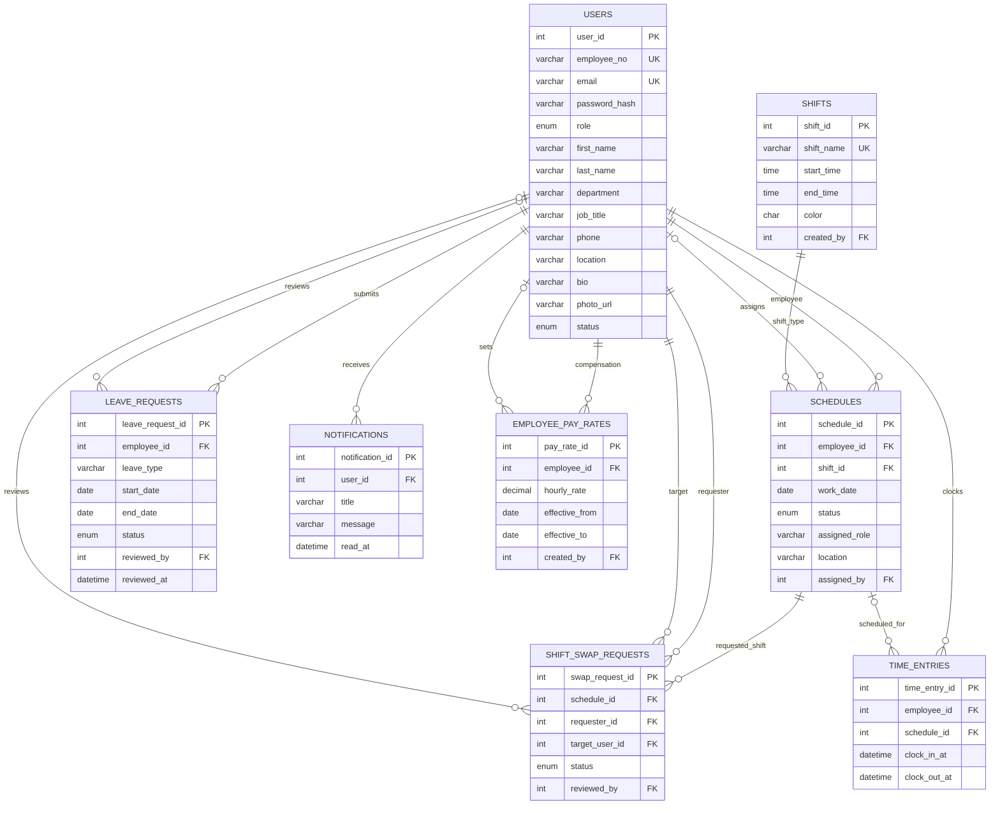

# ShiftSync Database Design

The development schema supports the current dashboard's users, employee profiles, shift types and assignments, leave decisions, shift swaps, time-clock records, notifications, and protected compensation data. It is a foundation only; the frontend is not connected to these tables yet.

`schema.sql` is the non-destructive initial schema used by `bin/migrate.php`. It does not create or select a database and does not drop or alter tables. The initializer applies it only to a fresh database and refuses to initialize a database containing untracked application tables. Do not execute it directly against an existing database.

## ER diagram

## Tables and constraints

| Table | Purpose | Important constraints and indexes |
|---|---|---|
| `users` | Employee/admin identity and contact/profile data, including photo URL | Unique employee number and email; role/status index; `password_hash` stores a PHP password hash, never plaintext |
| `shifts` | Reusable named shift types, including start/end times | Unique shift name; creator references `users`; valid time range and color |
| `schedules` | Employee assignment of a shift type to a work date, with assigned role and location | Unique `(employee_id, work_date)`; foreign keys to employee, shift type, and assigning admin; date and shift indexes |
| `leave_requests` | Leave submissions and review decisions | Date range check; status/reviewer/timestamp; employee/status and review-date indexes |
| `shift_swap_requests` | Requested transfer of a scheduled shift to a coworker | References schedule, requester, target, and reviewer; requester/target distinctness is checked by the application; status queue indexes |
| `time_entries` | Clock-in/out sessions, including open sessions | UTC timestamps; optional scheduled shift; generated unique key permits at most one open entry per employee |
| `notifications` | Per-user notification content and read state | User foreign key; user/read/date index |
| `employee_pay_rates` | Effective-dated hourly compensation, separate from general profile access | Positive decimal rate; employee/effective-date uniqueness and index; creator foreign key |
| `schema_migrations` | Applied migration versions | Created and written by the guarded initializer |

The application must enforce non-overlapping effective pay-rate ranges, employee/admin access checks, leave overlap rules, availability before assigning/approving a shift, swap authorization, and accurate time-clock ownership. MySQL constraints alone cannot enforce those business rules.

## Changes from the original four-table design

- Preserved the existing `users`, `shifts`, `schedules`, and `leave_requests` concepts and their foreign-key relationships.
- Added employee profile fields (`job_title`, `phone`, `location`, `bio`) to `users`.
- Added the profile `photo_url` used by the current account and team views.
- Added schedule status to represent pending/confirmed/cancelled assignments.
- Added per-assignment `assigned_role` and `location` fields used by the shift roster.
- Made leave type a bounded `VARCHAR` so the current form's additional types fit without silent enum rejection; retained status, review, remark, and date fields.
- Added `shift_swap_requests` to persist the schedule being transferred, both employees, request reason, decision, and reviewer.
- Added `time_entries` for clock sessions rather than storing display-formatted times and durations.
- Added `notifications` with per-user read timestamps.
- Added `employee_pay_rates` separately from ordinary profile data; APIs must restrict this data and payroll summaries to administrators.
- Added migration `002_dashboard_profile_schedule_fields` to extend an already initialized Phase 1 development database without recreating tables or deleting rows.
- Payroll totals are derived from scheduled shifts or time entries and effective rates. No stored payroll-summary table is introduced in this phase.

The former `schema.sql` began with `DROP TABLE` statements. This has been replaced with a non-destructive fresh-database baseline. The initializer does not migrate or modify the old schema: it stops if application tables already exist without a recorded foundation migration. Review and plan a separate data-preserving migration before using an existing database.

## Security and scope

- No public account registration or self-selected administrator role is introduced.
- Real authentication is not implemented in this phase. Future authentication must use `password_hash()` / `password_verify()`, secure server-side sessions, and role authorization on every protected operation.
- Hourly rates are sensitive. Keep them out of employee-facing queries and exports; enforce administrator authorization in the server/API layer.
- Database credentials are read from environment variables and must never be committed.
